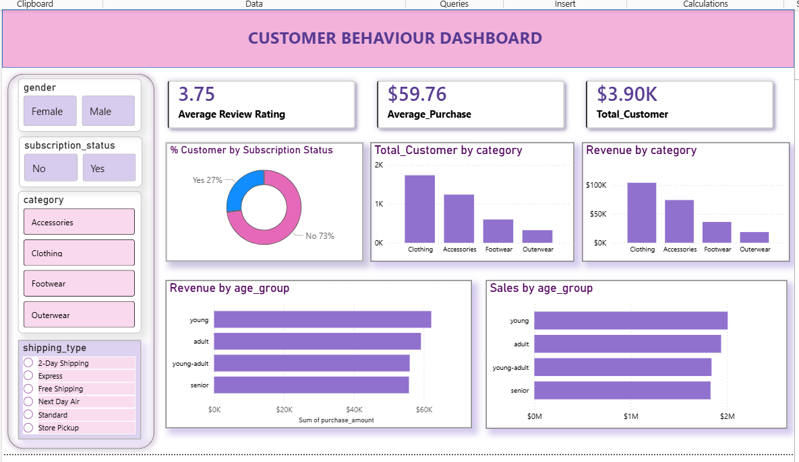

# 🛍️ Customer Shopping Behaviour Analysis
### End-to-end data analysis using **Python**, **MySQL** and **Power BI**

> Cleaning and feature engineering in Python → analysis with SQL → interactive Power BI dashboard → business insights.



---

## 📌 Table of Contents
1. [Project Overview](#-project-overview)
2. [Business Objectives](#-business-objectives)
3. [Dataset Description](#-dataset-description)
4. [Tools & Technologies](#-tools--technologies)
5. [Project Workflow](#-project-workflow)
6. [Data Cleaning & Feature Engineering (Python)](#-data-cleaning--feature-engineering-python)
7. [SQL Analysis](#-sql-analysis)
8. [Power BI Dashboard](#-power-bi-dashboard)
9. [Key Insights](#-key-insights)
10. [Recommendations](#-recommendations)
11. [Repository Structure](#-repository-structure)
12. [How to Run](#-how-to-run)
13. [Limitations & Future Work](#-limitations--future-work)
14. [Acknowledgements](#-acknowledgements)
15. [Author](#-author)

---

## 📖 Project Overview

This project analyses the shopping behaviour of **3,900 customers** of a retail store to understand **who buys, what they buy, how much they spend and what influences their spending** (gender, age, subscription, discounts, shipping type, purchase history).

The workflow follows a real-world analyst pipeline:

1. **Python (pandas)** – clean the raw CSV, handle missing values, create new features.
2. **MySQL** – store the cleaned data and answer business questions with SQL.
3. **Power BI** – build an interactive *Customer Behaviour Dashboard* for decision makers.

---

## 🎯 Business Objectives

- Which **gender, age group and product category** generate the most revenue?
- Do **subscribed customers** spend more than non-subscribers?
- Do **discounts** attract customers who still spend above average?
- Does the **shipping type** affect the purchase amount?
- Which **products** are best rated and most popular in each category?
- How **loyal** is the customer base (new vs returning vs loyal)?

---

## 🗂️ Dataset Description

| Item | Details |
|---|---|
| **File** | `data/dataset.csv` |
| **Rows × Columns** | 3,900 × 18 |
| **Domain** | Retail / customer shopping behaviour |
| **Missing values** | 37 in `Review Rating` (all other columns complete) |
| **Unique products** | 25 items across 4 categories (Clothing, Accessories, Footwear, Outerwear) |
| **Unique locations** | 50 |

**Columns**

| Column | Description |
|---|---|
| Customer ID | Unique customer identifier |
| Age | Customer age (18–70) |
| Gender | Male / Female |
| Item Purchased | Product bought (e.g. Blouse, Jeans, Sandals) |
| Category | Clothing, Accessories, Footwear, Outerwear |
| Purchase Amount (USD) | Amount spent ($20–$100) |
| Location | Customer's state |
| Size, Color, Season | Product attributes and season of purchase |
| Review Rating | Rating given (2.5–5.0) |
| Subscription Status | Whether the customer is subscribed (Yes/No) |
| Shipping Type | Free Shipping, Standard, Express, Next Day Air, 2-Day Shipping, Store Pickup |
| Discount Applied | Whether a discount was used (Yes/No) |
| Promo Code Used | Whether a promo code was used (Yes/No) |
| Previous Purchases | Number of earlier purchases |
| Payment Method | Credit Card, PayPal, Cash, Debit Card, Venmo, Bank Transfer |
| Frequency of Purchases | Weekly, Fortnightly, Monthly, Quarterly, Annually, etc. |

---

## 🧰 Tools & Technologies

| Purpose | Tool |
|---|---|
| Data cleaning & feature engineering | Python 3, pandas, NumPy |
| Database connection | SQLAlchemy, mysql-connector-python |
| Data storage & analysis | MySQL |
| Visualisation | Power BI Desktop |
| Version control | Git & GitHub |

---

## 🔄 Project Workflow

```
 dataset.csv  ──►  Python (pandas)  ──►  MySQL (SALES_ANALYSIS.SALES)  ──►  SQL queries  ──►  Power BI  ──►  Insights
   (raw data)     clean + transform      load via SQLAlchemy              business Q&A      dashboard
```

---

## 🧹 Data Cleaning & Feature Engineering (Python)

Script: [`python/project.py`](project.py)

| Step | What was done | Why |
|---|---|---|
| 1. Load data | Read `dataset.csv` with pandas | Starting point |
| 2. Missing values | Filled the 37 missing `Review Rating` values with the **median rating of the same product category** | Keeps category-level patterns instead of using one global value |
| 3. Column names | Converted to lowercase and replaced spaces with `_`; renamed `purchase_amount_(usd)` → `purchase_amount` | SQL-friendly column names |
| 4. Age groups | Created `age_group` using `pd.qcut` (4 equal-sized quartiles): **young (18–31), young-adult (32–44), adult (45–57), senior (58–70)** | Segment customers for analysis |
| 5. Purchase frequency | Mapped `frequency_of_purchases` to numeric `frequency_days` (e.g. Weekly = 7, Monthly = 30, Quarterly = 90, Annually = 365) | Makes frequency comparable and sortable |
| 6. Drop redundant column | Removed `promo_code_used` (it has the same Yes/No distribution as `discount_applied`) | Avoids duplicate information |
| 7. Load to MySQL | Wrote the cleaned DataFrame to table `SALES` in database `SALES_ANALYSIS` using SQLAlchemy | Enables SQL analysis and Power BI connection |

```python
# Example: fill missing ratings using the category median
data["Review Rating"] = data["Review Rating"].fillna(
    data.groupby("Category")["Review Rating"].transform("median")
)

# Example: age groups
labels = ["young", "young-adult", "adult", "senior"]
data["age_group"] = pd.qcut(data["age"], q=4, labels=labels)
```

---

## 🗄️ SQL Analysis

File: [`sql/queries.sql`](sales_analysis/New_Query_1793866587960.sql) — 10 business questions answered on the `SALES` table.

| # | Business question | SQL concepts used | Result |
|---|---|---|---|
| 1 | Total revenue by gender | `GROUP BY`, `SUM` | Male **$157,890** vs Female **$75,191** |
| 2 | Customers who used a discount but still spent **above the average** purchase | Subquery, `WHERE` | **839** customers |
| 3 | Top 5 highest-rated products | `AVG`, `ROUND`, `ORDER BY`, `LIMIT` | Gloves (3.86), Sandals (3.84), Boots (3.82), Hat (3.80), Handbag (3.78) |
| 4 | Average purchase: Express vs Standard shipping | `AVG`, `IN` | Express **$60.48** vs Standard **$58.46** |
| 5 | Do subscribers spend more? (average spend & total revenue) | `GROUP BY`, `AVG`, `SUM` | Subscribers $59.49 avg / $62,645 total; Non-subscribers $59.87 avg / $170,436 total |
| 6 | Top 5 products with the highest % of discounted purchases | `CASE WHEN`, aggregation | Hat (50.0%), Sneakers (49.7%), Coat (49.1%), Sweater (48.2%), Pants (47.4%) |
| 7 | Customer segmentation by previous purchases | `CASE WHEN`, `COUNT` | Loyal **3,116**, Returning **701**, New **83** |
| 8 | Top 3 products within each category | CTE, `ROW_NUMBER() OVER (PARTITION BY …)` | See insight section |
| 9 | Are repeat buyers (>5 purchases) likely to subscribe? | `WHERE`, `GROUP BY` | 958 subscribed vs 2,518 not subscribed |
| 10 | Revenue contribution of each age group | `GROUP BY` | young $62,143 · adult $59,197 · young-adult $55,978 · senior $55,763 |

**Customer segment logic (Query 7):** `previous_purchases = 1` → *new*; `2–10` → *returning*; `> 10` → *loyal*.

<details>
<summary><b>Sample query – Top 3 products in each category</b></summary>

```sql
WITH R AS (
    SELECT category, item_purchased,
           COUNT(customer_id) AS total_orders,
           ROW_NUMBER() OVER (PARTITION BY category ORDER BY COUNT(customer_id) DESC) AS top_product
    FROM SALES
    GROUP BY category, item_purchased
)
SELECT category, item_purchased, total_orders, top_product
FROM R
WHERE top_product <= 3;
```
</details>

---

## 📊 Power BI Dashboard

File: [`powerbi/youtube.pbix`](powerbi/youtube.pbix) — **Customer Behaviour Dashboard** (connected to the MySQL `SALES` table).


**KPI cards**
- Average Review Rating
- Average Purchase Amount
- Total Customers

**Visuals**

| Visual | Type | Purpose |
|---|---|---|
| Revenue by category | Clustered column chart | Which category earns the most |
| Total_Customer by category | Clustered column chart | Customer count per category |
| % Customer by Subscription Status | Donut chart | Subscriber vs non-subscriber share |
| Revenue by age_group | Clustered bar chart | Spending by age segment |
| Sales by age_group | Clustered bar chart | Customer volume by age segment |

**Interactive slicers:** Gender · Subscription Status · Category · Shipping Type

**DAX measures**

```dax
Average Review Rating = AVERAGE('sales_analysis sales'[review_rating])

Average_Purchase = AVERAGE('sales_analysis sales'[purchase_amount])

Total_Customer = COUNT('sales_analysis sales'[customer_id])
```

---

## 💡 Key Insights

**Overall:** 3,900 customers generated **$233,081** in revenue, with an average purchase of **$59.76** and an average review rating of **3.75 / 5**.

1. **Clothing is the revenue driver.** Clothing brings **$104,264 (≈ 44.7%)** of revenue, followed by Accessories **$74,200 (≈ 31.8%)**, Footwear **$36,093 (≈ 15.5%)** and Outerwear **$18,524 (≈ 7.9%)**.
2. **Male customers bring ~68% of revenue, but mainly because there are more of them.** Males are 2,652 of 3,900 customers; the average spend per purchase is almost the same (Male ≈ $59.5 vs Female ≈ $60.3).
3. **Subscribers do not spend more per purchase.** Average spend is $59.49 (subscribers) vs $59.87 (non-subscribers). Only **27%** of customers are subscribed, so subscription is an *untapped* area rather than a proven revenue booster.
4. **Discounts are widely used.** 1,677 of 3,900 purchases (**43%**) used a discount, and **839** of those customers still spent above the average purchase amount — so discounts do not necessarily mean low-value orders.
5. **Customer base is highly loyal.** About **80%** of customers (3,116) have more than 10 previous purchases; only 83 are new customers → strong retention, weak new-customer acquisition.
6. **Express shipping has a slightly higher average order value** ($60.48 vs $58.46 for Standard), but the difference is small (~$2).
7. **Revenue is spread evenly across age groups** (each ≈ 24–27%), with the youngest quartile (18–31) contributing the most ($62,143).
8. **Top products per category:** Clothing – Blouse, Pants, Shirt · Accessories – Jewelry, Belt, Sunglasses · Footwear – Sandals, Shoes, Sneakers · Outerwear – Jacket, Coat.
9. **Product ratings are tightly clustered** (best: Gloves 3.86), so no product is dramatically better or worse rated.
10. **Repeat buyers are not more likely to subscribe:** among customers with >5 purchases, 958 of 3,476 (≈ 27.6%) are subscribed — almost the same as the overall 27%.

---

## ✅ Recommendations

- **Grow the subscription programme** – offer subscriber-only benefits (free shipping, early access) because 73% of customers are not subscribed and subscribers currently spend no more.
- **Focus marketing on Clothing and Accessories** (≈ 76% of revenue) while testing bundles to lift Footwear and Outerwear.
- **Reward loyal customers and invest in acquisition** – the base is loyal, but only 83 customers are new.
- **Use discounts selectively** – popular on Hats, Sneakers and Coats; test whether lower discount levels keep the same sales.
- **Promote Express shipping** as a premium option, since it is linked to slightly higher order values.
- **Target female customers** with campaigns – they spend as much per order but make up only ~32% of customers.

---

## 📁 Repository Structure

```
customer-shopping-behaviour-analysis/
├── data/
│   └── dataset.csv
├── python/
│   └── project.py
├── sql/
│   └── queries.sql
├── powerbi/
│   └── youtube.pbix
├── images/
│   └── dashboard.png
├── requirements.txt
└── README.md
```

---

## ▶️ How to Run

**1. Clone the repository**
```bash
git clone https://github.com/<your-username>/<repo-name>.git
cd <repo-name>
```

**2. Install dependencies** (`requirements.txt`)
```
pandas
numpy
sqlalchemy
mysql-connector-python
```
```bash
pip install -r requirements.txt
```

**3. Set up MySQL**
```sql
CREATE DATABASE SALES_ANALYSIS;
```

**4. Add your MySQL credentials and run the Python script**

Set your credentials as environment variables (do **not** hard-code passwords):
```bash
export DB_USER=root
export DB_PASSWORD=your_password
python python/project.py
```
This cleans the data and creates the `SALES` table in `SALES_ANALYSIS`.

**5. Run the SQL queries**

Open `sql/queries.sql` in MySQL Workbench and run the queries one by one.

**6. Open the dashboard**

Open `powerbi/youtube.pbix` in Power BI Desktop → *Transform data → Data source settings* and point it to your own MySQL server if needed.

---

## ⚠️ Limitations & Future Work

- The dataset has no date/time column, so **trend and seasonality over time** cannot be analysed (only the `Season` field).
- Findings are descriptive; no statistical tests or predictive models were built.
- Future ideas: customer segmentation with RFM/K-Means, churn or subscription prediction, and Python visualisations (seaborn/matplotlib) to complement the dashboard.

---

## 🙏 Acknowledgements

This project was built by following and extending a YouTube tutorial: **[Project reference video](https://youtu.be/5PrZvPeUw60)** — thanks to the creator <!-- add creator/channel name here -->. Dataset: customer shopping behaviour dataset <!-- add the dataset source link, e.g. Kaggle -->.

---

## 👤 Author

Nandani Assudani
BCA Graduate | Aspiring Data Analyst
📧 nandaniassudani@gmail.com· 🔗 https://www.linkedin.com/in/nandani-assudani-029a38288  · 💻 
nandaniasudani-a11y

⭐ If you found this project useful, please star the repository!


